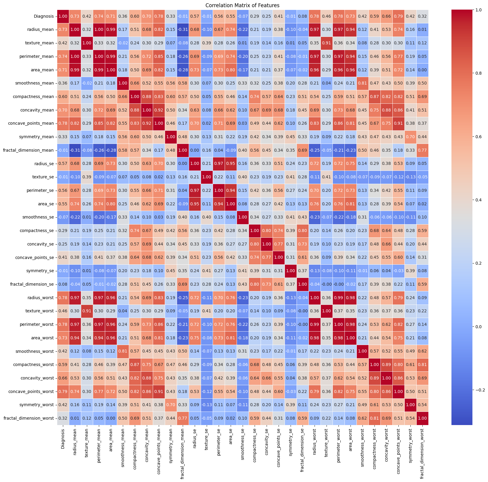
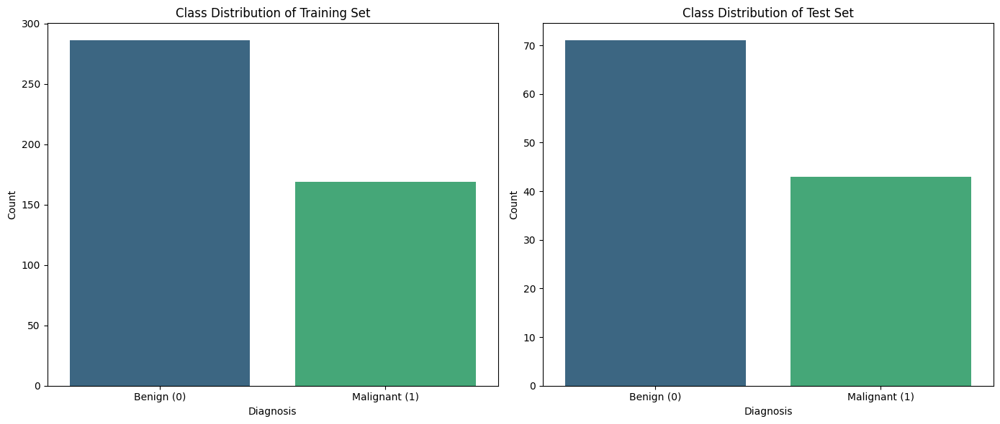
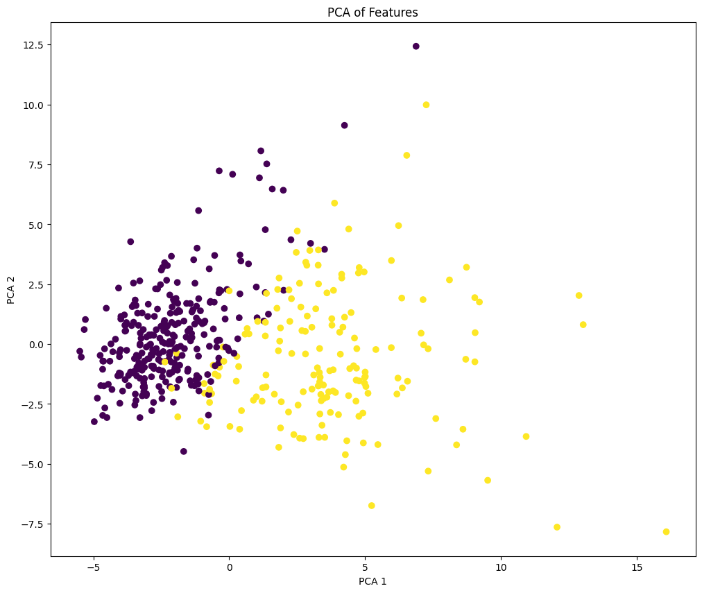
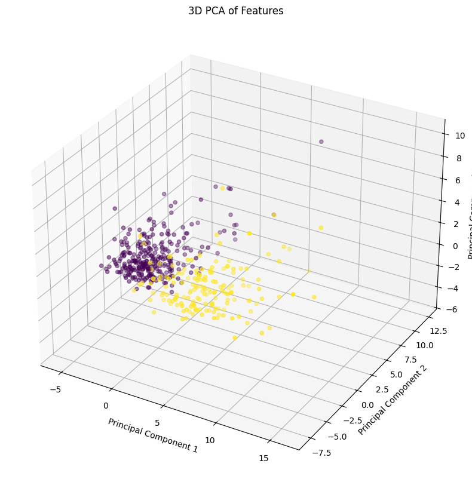
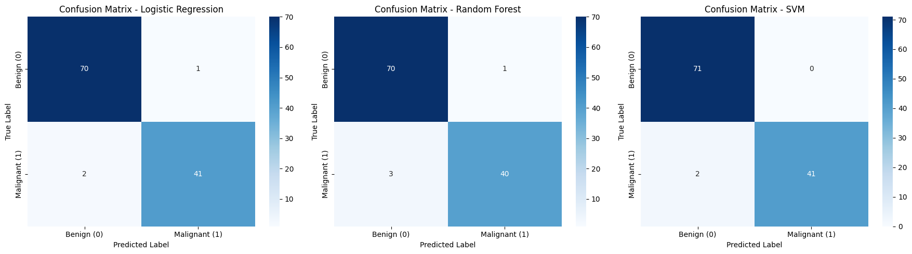
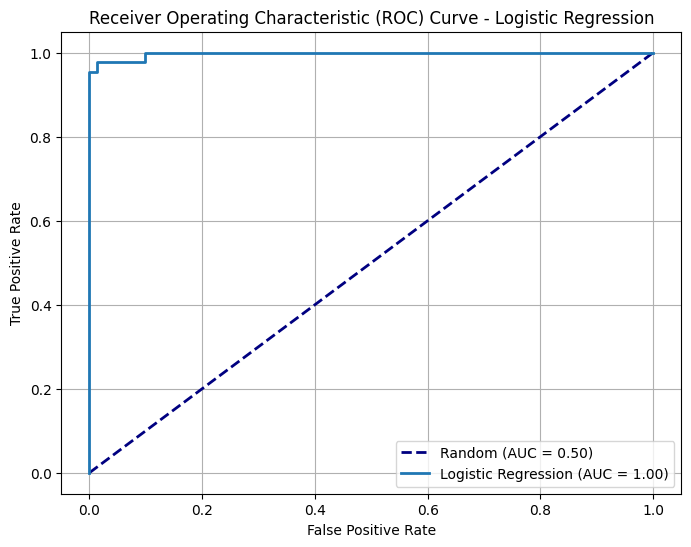
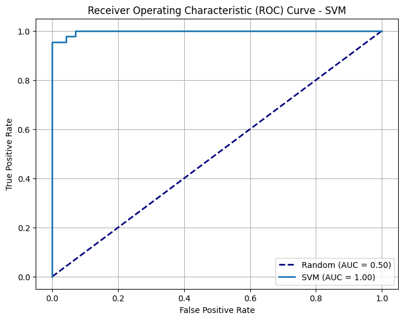
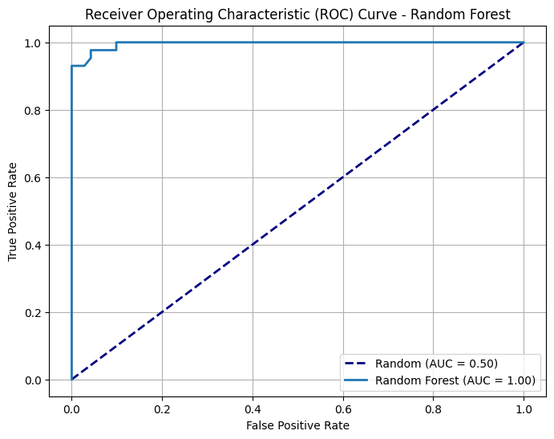

# Breast Cancer Classification with Machine Learning

A complete data science pipeline that classifies breast tumours as **benign** or **malignant** using the **Breast Cancer Wisconsin (Diagnostic)** dataset. Three supervised models are trained and compared: **Logistic Regression**, **Support Vector Machine (SVM)** and **Random Forest**.

> **Best model: SVM (RBF kernel): 98.2% accuracy, ROC-AUC 0.997, and zero benign cases misclassified as malignant.**

Built by **Palihawadana Perera** as part of the *Data Science for Applied AI* module, University of Bradford.

---

## Table of contents
- [Project overview](#project-overview)
- [Repository structure](#repository-structure)
- [Dataset](#dataset)
- [What I did](#what-i-did)
  - [1. Data loading and preprocessing](#1-data-loading-and-preprocessing)
  - [2. Exploratory data analysis](#2-exploratory-data-analysis)
  - [3. PCA visualisation](#3-pca-visualisation)
  - [4. Model training](#4-model-training)
  - [5. Evaluation](#5-evaluation)
- [Results](#results)
- [Key findings](#key-findings)
- [Limitations and future work](#limitations-and-future-work)
- [How to run](#how-to-run)
- [Tech stack](#tech-stack)
- [References](#references)

---

## Project overview

Breast cancer is one of the most common cancers in the world. It is usually diagnosed with a mix of clinical examination, imaging and biopsy, where a small tissue sample taken with a fine needle is examined under a microscope. Machine learning can support that process by spotting subtle patterns in measurements of the cell nuclei, giving clinicians a fast and consistent second opinion.

**Aim:** develop an accurate and practical pipeline for binary classification of breast tumours.

**Objectives**
- Carry out exploratory data analysis (EDA) to understand the features and how they relate to each other
- Preprocess the raw data (encode the labels, drop columns that are not features)
- Visualise class separation with Principal Component Analysis (PCA)
- Train and compare Logistic Regression, SVM and Random Forest
- Evaluate with accuracy, precision, recall, F1-score, confusion matrices and ROC-AUC
- Discuss interpretability, limitations and real-world implications

## Repository structure

```
├── Breast_Cancer_Model.ipynb   # Full notebook: EDA, PCA, training and evaluation
├── data/
│   └── wdbc.csv                # Breast Cancer Wisconsin (Diagnostic) dataset
├── screenshots/                # Plots exported from the notebook
├── requirements.txt
└── README.md
```

## Dataset

| Property | Value |
|---|---|
| Source | [UCI Machine Learning Repository: Breast Cancer Wisconsin (Diagnostic)](https://archive.ics.uci.edu/dataset/17/breast+cancer+wisconsin+diagnostic) |
| Samples | 569 |
| Columns | 32 (ID, Diagnosis, and 30 numerical features) |
| Target | `Diagnosis`: M = Malignant (1), B = Benign (0) |
| Class balance | 357 benign (63%) / 212 malignant (37%) |
| Missing values | None |

The original `wdbc.data` file was converted to CSV. It has no header row, so the column names are assigned in the notebook.

The 30 features are computed from a digitised image of a fine needle aspirate (FNA) of a breast mass. They describe **10 characteristics of the cell nuclei**, each recorded as a **mean**, a **standard error** and a **worst** (largest) value:

| Feature | What it measures | Clinical interpretation |
|---|---|---|
| Radius | Distance from the centre of the nucleus to its perimeter | Larger nuclei can indicate malignancy |
| Texture | Standard deviation of grey-scale intensity | Cancerous cells have more irregular texture |
| Perimeter | Length of the nucleus boundary | Longer, irregular boundaries suggest malignancy |
| Area | Pixels inside the nucleus contour | Cancerous cells often have larger nuclei |
| Smoothness | Local variation in radius lengths | Low smoothness (high variation) is seen in cancer cells |
| Compactness | perimeter² / area − 1.0 | Higher means a more irregular shape |
| Concavity | Severity of concave parts of the contour | Cancerous cells have deeper concave regions |
| Concave points | Number of concave parts of the contour | More concave points mean more irregular nuclei |
| Symmetry | How symmetric the nucleus is | Cancer cells tend to be less symmetric |
| Fractal dimension | "Coastline approximation" − 1 | Higher means a more complex, irregular outline |

## What I did

### 1. Data loading and preprocessing
- Loaded the CSV with **pandas** and assigned the 32 column names from the UCI documentation
- Encoded the target: `M → 1`, `B → 0`. Numeric labels allow probability outputs, simpler metric calculation and more efficient computation
- Dropped the `ID` column, which carries no predictive information
- Confirmed there are **no missing values**
- Split the data **80/20** into training and test sets (`random_state=42`)
  - Train: 286 benign / 169 malignant
  - Test: 71 benign / 43 malignant
- Wrapped scaling (`StandardScaler`) and each model in a **scikit-learn `Pipeline`**, so the scaler is fitted only on training data and no information leaks from the test set

### 2. Exploratory data analysis

**Correlation heatmap**: shows how strongly each pair of features is related. Size-related features (radius, perimeter, area) are almost perfectly correlated with each other, which means some information is redundant. This can cause multicollinearity in Logistic Regression, while SVM and Random Forest are more robust to it. Because the dataset has only 30 clean features, no feature selection was needed.



**Class distribution**: the classes are moderately imbalanced (63% vs 37%). That is not severe enough to require resampling, but because this is a medical problem, **recall on malignant cases** was treated as an important metric.



### 3. PCA visualisation
PCA was used **only for visualisation**, not to create new features, to check whether benign and malignant samples separate naturally. The 2D and 3D projections show clear but not perfect separation, with some overlap near the boundary. This suggested that both linear and non-linear classifiers could learn the pattern, which justified comparing models of different complexity.

| 2D PCA | 3D PCA |
|---|---|
|  |  |

### 4. Model training

| Model | Configuration | Why it was chosen |
|---|---|---|
| Logistic Regression | `StandardScaler` → `LogisticRegression(max_iter=1000)` | Interpretable baseline, widely used in medical research |
| Support Vector Machine | `StandardScaler` → `SVC(kernel='rbf', probability=True)` | Strong for binary classification; the RBF kernel captures non-linear boundaries |
| Random Forest | `RandomForestClassifier(n_estimators=200, random_state=42)` | Ensemble of decision trees, robust to correlated features and needs no scaling |

### 5. Evaluation
Each model was evaluated on the held-out test set (114 samples) using:
- Accuracy, precision, recall and F1-score (weighted)
- Confusion matrices
- ROC curves and AUC

## Results

| Model | Accuracy | Precision | Recall | F1-score | ROC-AUC |
|---|---|---|---|---|---|
| Logistic Regression | 97.37% | 97.37% | 97.37% | 97.36% | 0.997 |
| **SVM (RBF)** | **98.25%** | **98.29%** | **98.25%** | **98.24%** | **0.997** |
| Random Forest | 96.49% | 96.52% | 96.49% | 96.47% | 0.996 |

*Precision, recall and F1 are weighted averages across both classes.*

**Confusion matrices**



| Model | False positives (benign predicted as malignant) | False negatives (malignant predicted as benign) |
|---|---|---|
| Logistic Regression | 1 | 2 |
| SVM | **0** | 2 |
| Random Forest | 1 | 3 |

**ROC curves**

| Logistic Regression | SVM | Random Forest |
|---|---|---|
|  |  |  |

## Key findings
- **All three models scored above 95% accuracy** and ROC-AUC above 0.99, so the nuclear features are highly informative
- **SVM performed best**: 98.25% accuracy, 100% precision on malignant cases (no false alarms) and 95% recall on malignant cases
- Malignant tumours show clearly higher values for **size and shape features** (radius, perimeter, area, concavity), which matches clinical knowledge
- Using pipelines kept the evaluation honest by preventing data leakage from scaling

## Limitations and future work
- **Small dataset** (569 samples) from a single source, so results may not generalise to other hospitals or populations
- A few **false negatives** remain (2 to 3 malignant cases missed). In a clinical setting these are the costliest errors, so threshold tuning to favour recall would be a sensible next step
- Results come from a single train/test split; **k-fold cross-validation** and **hyperparameter tuning** (e.g. `GridSearchCV`) would give more robust estimates
- Explainability tools such as **SHAP** or feature importances would help clinicians trust the model's decisions
- Any model like this should **support, not replace**, clinical judgement

## How to run

```bash
git clone https://github.com/Thaindu1999/Breast-Cancer-Classification-ML-.git
cd Breast-Cancer-Classification-ML-
pip install -r requirements.txt
jupyter notebook Breast_Cancer_Model.ipynb
```

The notebook was built in Google Colab and loads the dataset from Google Drive. To use the copy in this repository instead, change the loading cell to:

```python
df = pd.read_csv("data/wdbc.csv", header=None)
```

## Tech stack
Python · pandas · NumPy · scikit-learn · Matplotlib · Seaborn · Jupyter / Google Colab

## References
- Wolberg, W., Mangasarian, O., Street, N., & Street, W. (1993). *Breast Cancer Wisconsin (Diagnostic)*. UCI Machine Learning Repository. https://doi.org/10.24432/C5DW2B
- World Health Organization. (2025). *Breast cancer*. https://www.who.int/news-room/fact-sheets/detail/breast-cancer
- Ahmad, J., Akram, S., Jaffar, A., et al. (2024). *Deep learning empowered breast cancer diagnosis: Advancements in detection and classification.*
